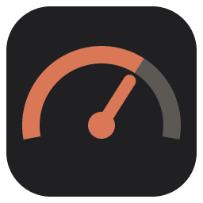
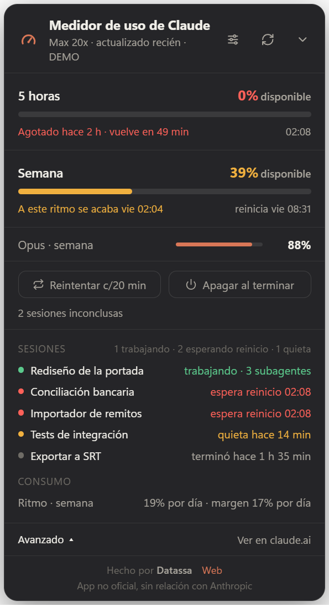
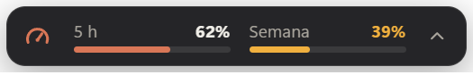

<div align="center">



# Medidor de uso de Claude

**Un widget chico y siempre visible para Windows que muestra cuánto consumiste de tus límites de Claude,<br>cuánto te queda y si al ritmo actual llegás hasta el reinicio.**

[](https://github.com/MateoPelassa/Claude-Usage-Meter-by-Datassa/actions/workflows/test.yml)
[](LICENSE)


[English](README.md) · **Español**



*Achicado, es una barra fina que podés dejar en una esquina:*



</div>

> **No oficial.** Este proyecto no tiene relación con Anthropic, ni su aval ni su soporte. "Claude" es una marca de Anthropic.

## Contenido

[Qué hace](#qué-hace) · [Instalación](#instalación) · [De dónde salen los datos](#de-dónde-salen-los-datos) · [Privacidad](#privacidad) · [Botones de automatización](#los-dos-botones-de-automatización) · [Opciones](#opciones) · [Desarrollo](#desarrollo)

## Qué hace

- **Límites de 5 horas y semanal** de un vistazo, más los límites semanales por modelo si tu plan los tiene.
- **Un pronóstico en vez de un número suelto.** Guarda un historial local de lecturas y usa tu ritmo reciente (última hora para el límite de 5 horas, últimas 24 horas para el semanal) para decirte una de tres cosas: *te alcanza hasta el reinicio*, *a este ritmo se acaba 22:40* o *agotado, vuelve en 49 min*.
- **Avisos** al 80% y 95%, cuando tu ritmo va a agotar un límite pronto y cuando un límite agotado se reinicia.
- **Panel Avanzado** con tus sesiones recientes de Claude Code: trabajando (con sus subagentes), esperando el reinicio de un límite, quietas a mitad de un paso o terminadas.
- **Reintentar** *(opcional, experimental)*: cada N minutos retoma las sesiones de Claude Code que se cortaron por un tope de consumo.
- **Apagar al terminar** *(opcional)*: apaga la PC cuando no queda nada inconcluso.
- En español e inglés. Las barras pueden mostrar lo consumido o lo disponible.

## Instalación

Necesita Windows y [Node.js](https://nodejs.org) 20 o superior.

```bash
git clone https://github.com/MateoPelassa/Claude-Usage-Meter-by-Datassa.git
cd Claude-Usage-Meter-by-Datassa
npm install
npm start
```

Para verlo con datos de ejemplo y sin cuenta:

```bash
npm run demo
```

El widget vive en la bandeja del sistema. Con clic derecho en el ícono tenés los avisos, el inicio con Windows, iniciar o cerrar sesión y salir. No hay instalador armado; si querés uno, `npm run dist` lo genera en tu PC (no está firmado, así que Windows SmartScreen va a advertir).

## De dónde salen los datos

Leé esto antes de usarlo.

- El widget lee tu uso de las mismas direcciones que usan las apps de Claude: `api.anthropic.com/api/oauth/usage` y `claude.ai/api/organizations/.../usage`. **No son APIs públicas documentadas.** Pueden cambiar o dejar de funcionar en cualquier momento, y usarlas desde una herramienta de terceros puede no estar contemplado en los términos de Anthropic. Revisalos y usalo bajo tu responsabilidad.
- Para autenticarse usa la sesión que Claude Code ya guardó en `~/.claude/.credentials.json`, o un inicio de sesión de claude.ai que hacés dentro del widget.

### Sobre iniciar sesión dentro del widget

Una ventana de inicio de sesión dentro de una app de terceros es exactamente la forma que tiene una herramienta para robar credenciales, así que no deberías aceptar esta de palabra.

- **Puede que no la necesites.** Si usás Claude Code por terminal, su sesión guardada alcanza y el widget nunca te pide iniciar sesión. Esa sesión vence al tiempo y solo la renueva Claude Code por terminal, así que si usás únicamente la app de escritorio te va a ofrecer el inicio de sesión.
- **Qué entregás.** Al entrar, queda guardada una sesión completa de claude.ai en el perfil de navegador propio del widget, en tu PC. Da acceso a toda tu cuenta, no solo al uso. El widget solo la usa para llamar a las dos direcciones de arriba.
- **Cómo verificarlo.** La ventana no tiene barra de direcciones, así que su título muestra siempre el sitio real en el que estás (la página no puede cambiarlo). Todo el flujo es `openLogin` en [`main.js`](main.js), unas 35 líneas: carga `https://claude.ai/login` en una ventana aislada y la cierra cuando entraste.
- **Cómo deshacerlo.** Ícono de la bandeja → *Cerrar sesión de claude.ai* borra esa sesión guardada.
- "Continuar con Google" puede no funcionar en una ventana embebida, porque Google suele bloquearlas. En ese caso usá la opción por correo.

## Privacidad

- Tu token solo se lee en tu PC y solo se envía a `api.anthropic.com` / `claude.ai`. Nunca se renueva, se registra ni se manda a otro lado.
- No hay telemetría ni servidor. La configuración, el historial de uso y el registro de reintentos quedan en `%APPDATA%\medidor-uso-claude`.
- El panel Avanzado y el reintento leen tus registros de Claude Code en `~/.claude/projects`. Leen solo el final de cada archivo para saber en qué estado está la sesión; no suben ni modifican nada.
- Los únicos enlaces salientes son "Ver en claude.ai" y la web del autor.

## Los dos botones de automatización

Los dos vienen apagados y los activás vos.

**Reintentar c/N min.** Busca sesiones cuya última respuesta fue el error de tope de consumo (en las últimas 24 horas) y las retoma con `claude -p --resume <id>` desde la carpeta de la sesión. Si el widget ve que el tope sigue puesto, no gasta el intento. Una sesión que falla 6 veces se descarta.

- **Experimental:** la detección tiene pruebas y se corrió contra registros reales, pero retomar de punta a punta una sesión cortada de verdad todavía no está verificado.
- Las sesiones se retoman sin ventana, con tus permisos normales de Claude Code. Si una necesita una aprobación, se frena ahí. Podés pasar argumentos extra con `retryArgs` en `config.json`.

**Apagar al terminar.** Ejecuta `shutdown /s /f`, que **cierra todos los programas abiertos sin guardar**. Se dispara solo cuando no queda ninguna sesión cortada, no se está retomando nada y ninguna sesión de Claude Code escribió algo durante el tiempo de silencio configurado (10 minutos por defecto). Tenés una cuenta regresiva de 60 segundos con un botón Cancelar, y la opción nunca se guarda: después de reiniciar vuelve apagada.

## Opciones

Con el ícono de controles del widget: barras (consumido / disponible), idioma, avisos (activados o no, cuáles: al 80%, al 95%, por ritmo, al reiniciarse, y con o sin sonido), tamaño, opacidad, intervalo de reintento y silencio antes de apagar. `Ctrl` + rueda del mouse también lo agranda o achica.

## Desarrollo

```bash
npm test
```

- `main.js`: ventana, bandeja, avisos, IPC.
- `src/usage.js`: consulta y normaliza el uso.
- `src/history.js`: historial de lecturas y pronóstico.
- `src/sessions.js`: lee los registros de Claude Code para clasificar las sesiones.
- `src/automation.js`: reintento y apagado.
- `src/i18n.js`: todos los textos, en los dos idiomas (una prueba verifica que coincidan).
- `renderer/`: la interfaz del widget.

Por ahora solo Windows: el apagado, el inicio con Windows y el comportamiento de la ventana son propios de Windows.

## Autor

Hecho por [Datassa](https://datassa.com.ar).

## Licencia

[MIT](LICENSE)
