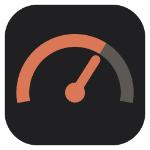
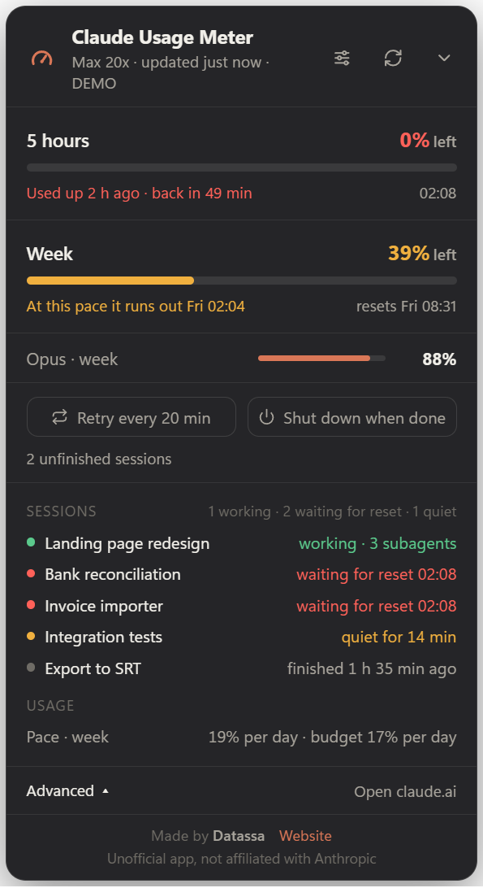
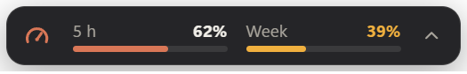

<div align="center">



# Claude Usage Meter

**A small always-on-top Windows widget that shows how much of your Claude limits you have used,<br>how much is left, and whether your current pace will last until the reset.**

[](https://github.com/MateoPelassa/Claude-Usage-Meter-by-Datassa/actions/workflows/test.yml)
[](LICENSE)


**English** · [Español](README.es.md)



*Collapsed, it is a thin bar you can park in a corner:*



</div>

> **Unofficial.** This project is not affiliated with, endorsed by, or supported by Anthropic. "Claude" is a trademark of Anthropic.

## Contents

[What it does](#what-it-does) · [Install](#install) · [Where the data comes from](#where-the-data-comes-from) · [Privacy](#privacy) · [Automation buttons](#the-two-automation-buttons) · [Options](#options) · [Development](#development)

## What it does

- **5-hour and weekly limits** at a glance, plus per-model weekly limits when your plan has them.
- **A forecast instead of a raw number.** It keeps a local history of readings and uses your recent pace (last hour for the 5-hour limit, last 24 hours for the weekly one) to tell you one of: *enough to last until the reset*, *at this pace it runs out at 22:40*, or *used up, back in 49 min*.
- **Alerts** at 80% and 95%, when your pace will exhaust a limit soon, and when an exhausted limit resets.
- **Advanced panel** listing your recent Claude Code sessions: working (with active subagents), waiting for a limit reset, quiet mid-step, or finished.
- **Retry** *(optional, experimental)*: every N minutes, resumes Claude Code sessions that were cut off by a usage limit.
- **Shut down when done** *(optional)*: powers the PC off once nothing is left unfinished.
- Spanish and English. Bars can show what you have used or what is left.

## Install

Requires Windows and [Node.js](https://nodejs.org) 20 or newer.

```bash
git clone https://github.com/MateoPelassa/Claude-Usage-Meter-by-Datassa.git
cd Claude-Usage-Meter-by-Datassa
npm install
npm start
```

To see it with sample data and no account:

```bash
npm run demo:en
```

The widget lives in the system tray. Right-click the tray icon for alerts, start with Windows, sign in/out and quit. There is no prebuilt installer; if you want one, `npm run dist` builds it locally (it is unsigned, so Windows SmartScreen will warn about it).

## Where the data comes from

Read this before you run it.

- The widget reads your usage from the same endpoints the Claude apps use: `api.anthropic.com/api/oauth/usage` and `claude.ai/api/organizations/.../usage`. **These are not documented public APIs.** They can change or stop working at any time, and using them from a third-party tool may not be covered by Anthropic's terms. Check them yourself and use this at your own risk.
- To authenticate it uses the session Claude Code already saved in `~/.claude/.credentials.json`, or a claude.ai sign-in you do inside the widget.

### About signing in inside the widget

A sign-in window inside a third-party app is exactly what a credential-stealing tool looks like, so you should not take this one on trust.

- **You may not need it.** If you use Claude Code in a terminal, its saved session is enough and the widget never asks you to sign in. That saved session expires after a while and only the Claude Code CLI renews it, so if you only use the desktop app you will be offered the sign-in instead.
- **What you hand over.** Signing in stores a full claude.ai session in the widget's own browser profile on your PC. It grants access to your whole account, not just usage. The widget only calls the two usage endpoints above with it.
- **How to check.** The window has no address bar, so its title always shows the real site you are on (the page cannot change it). The whole flow is `openLogin` in [`main.js`](main.js), about 35 lines: it loads `https://claude.ai/login` in an isolated, sandboxed window and closes it once you are in.
- **How to undo it.** Tray icon → *Sign out of claude.ai* deletes that stored session.
- "Continue with Google" may not work in an embedded window, since Google often blocks those. Use the email option if so.

## Privacy

- Your token is only read locally and only sent to `api.anthropic.com` / `claude.ai`. It is never refreshed, logged or sent anywhere else.
- There is no telemetry and no server. Settings, usage history and the retry log stay in `%APPDATA%\medidor-uso-claude`.
- The Advanced panel and the retry feature read your Claude Code transcripts in `~/.claude/projects`. They read only the end of each file to tell what state the session is in; nothing is uploaded or modified.
- The only outbound links are "Open claude.ai" and the author's website.

## The two automation buttons

Both are off by default and are yours to turn on.

**Retry every N min.** Looks for sessions whose last reply was the usage-limit error (within the last 24 hours) and resumes them with `claude -p --resume <id>` from the session's folder. If the widget can see the limit is still in place, it skips the attempt. A session that fails 6 times is dropped.

- **Experimental:** the detection is covered by tests and has been run against real transcripts, but resuming a real cut-off session end to end has not been verified yet.
- Resumed sessions run headless with your normal Claude Code permissions. If one needs an approval, it stops there. You can pass extra CLI arguments with `retryArgs` in `config.json`.

**Shut down when done.** Runs `shutdown /s /f`, which **closes every open program without saving**. It triggers only when no cut-off session is left, nothing is being resumed, and no Claude Code session has written anything for the configured quiet time (10 minutes by default). You get a 60-second countdown with a Cancel button, and the setting is never saved: after a restart it is off again.

## Options

Click the sliders icon in the widget: bars (used / left), language, size, opacity, retry interval and quiet time before shutdown. `Ctrl` + mouse wheel also resizes it.

## Development

```bash
npm test
```

- `main.js`: window, tray, notifications, IPC.
- `src/usage.js`: fetches and normalizes usage.
- `src/history.js`: reading history and the forecast.
- `src/sessions.js`: reads Claude Code transcripts to classify sessions.
- `src/automation.js`: retry and shutdown.
- `src/i18n.js`: all text, in both languages (a test checks they match).
- `renderer/`: the widget UI.

Windows only for now: shutdown, start-with-Windows and the window behaviour are Windows-specific.

## Author

Made by [Datassa](https://datassa.com.ar).

## License

[MIT](LICENSE)
